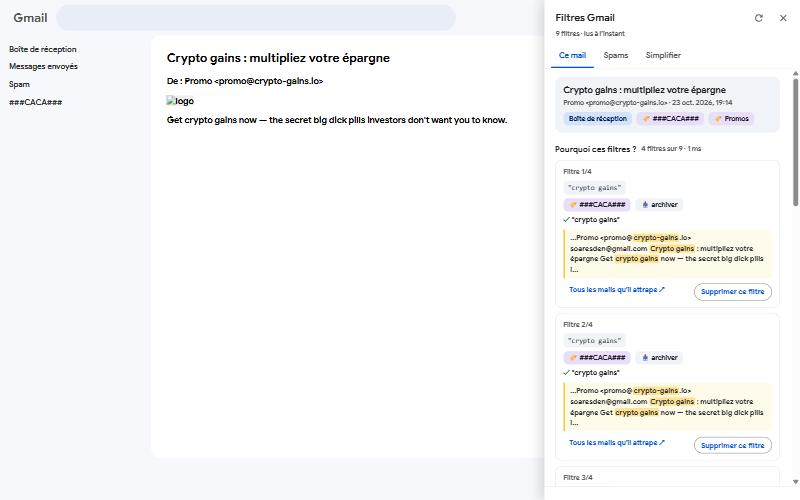
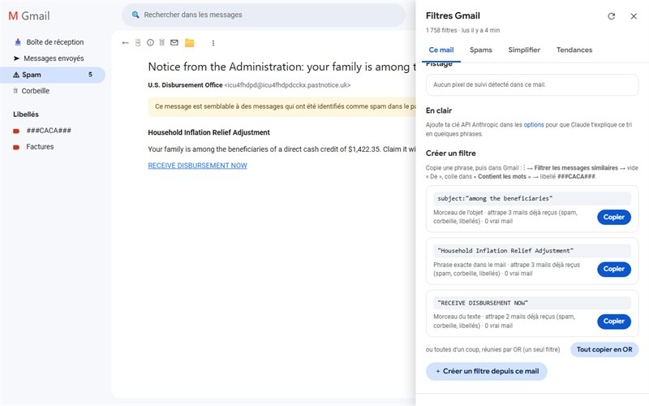
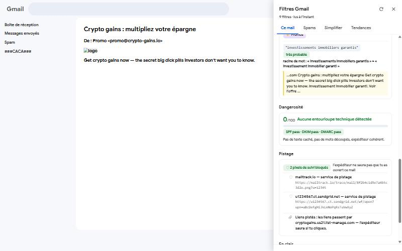
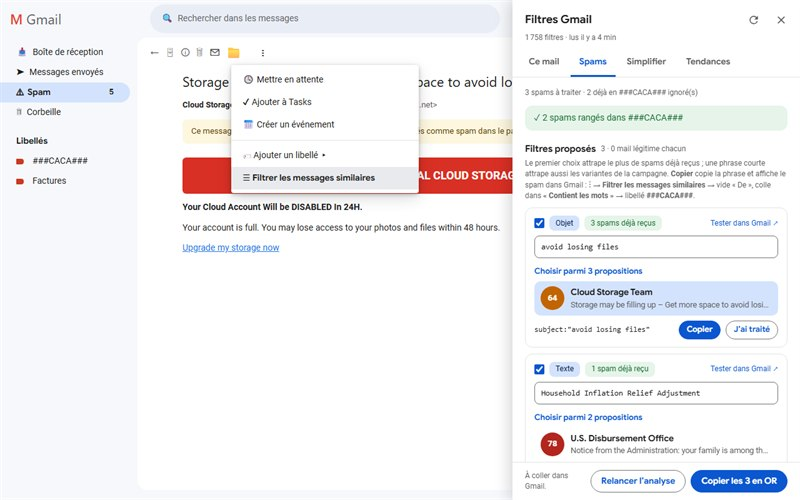
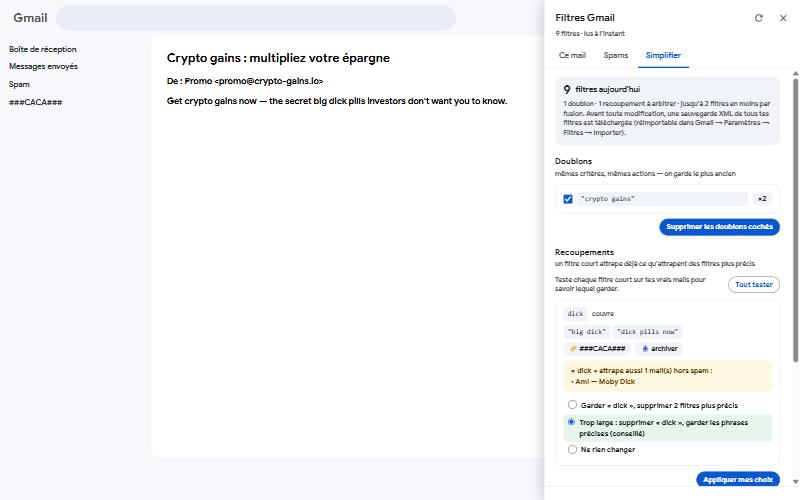
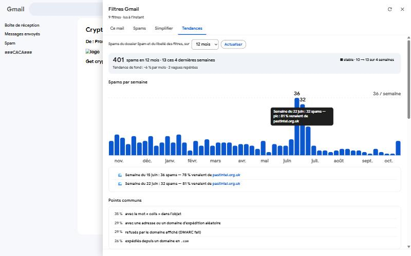

# Gmail-Filters-Detection

[Français](README.md) · **English**

A **Brave / Chrome** extension (Manifest V3) that lives inside Gmail and answers four questions:

1. **Why did this email get this filter?** — which filters it triggers, because of which phrase or sender, and where a label comes from when no filter explains it.
2. **Is this spam dangerous?** — a 0–100 score of technical tricks (hidden text, split letters, spoofed sender, deceptive links, SPF/DKIM/DMARC…), plus filters proposed automatically so it stops coming.
3. **Do my filters overlap?** — duplicates, filters that are too broad (`dick` also catching "Moby Dick"), possible merges.
4. **Where does all this spam come from?** — week-by-week trend, waves, and what the spam has in common (exact address targeted, domains, servers, sending platforms).

And, out of the box: **tracking pixels are blocked** in the emails you open.

> The screenshots come from the extension's test bench (fake Gmail inbox, fictitious data). The "Claude" texts in them are simulated. The interface is in French.

---

## Features

### This email: why these filters?



Open an email and click **Filtres** (bottom right):

- the filters it triggers, with their actions (label, archive, trash) and **the matching phrase highlighted in the email**;
- **labels with no exact filter**: "find the likely filter" (Gmail matches word stems: *investment* ≈ *investments*);
- **delete this filter** (with confirmation) or **create a filter** from a phrase selected in the email, with a **Test** button that counts the real emails it would catch;
- **Explain with Claude** (optional): a plain-language explanation that flags filters that are too broad.

### This email: suggest a filter



**✦ Proposer un filtre** splits the open email into phrases (subject and body) and tests them against your mailbox: only those that catch this spam and **no real email** are kept, most useful first. Each phrase is **copied** in one click, ready to paste into Gmail (⋮ → *Filter messages like these* → "Has the words"); **Tout copier en OR** combines them into a single filter.

### Danger and tracking



- **Danger**: 0–100 score and the list of tricks found (hidden text missing from the visible text, words split letter by letter, look-alike Unicode characters, links whose text shows one site but go elsewhere, display names imitating a brand, failing SPF/DKIM/DMARC…). Emails forwarded by an alias service (Firefox Relay, Apple Hide My Email, DuckDuckGo, SimpleLogin, addy.io, Proton Pass) are judged on their original sender, and sending platforms' click-tracking links don't count as traps.
- **Tracking**: blocked tracking pixels (service, reason), and links routed through a click counter.

### Spam folder: danger + automatic filters



- each spam with its **danger score**; one click **shows it in Gmail**, behind the panel;
- **proposed filters**, each tested against your real mailbox to catch that spam and **0 legitimate emails**: **words only** (exact subject or body phrase), never the sender — spammers change address with every send, not their wording. When nothing safe is found, Claude can suggest some (optional);
- **several proposals per spam**, best first: the one that catches the most spam already received, then the shortest (a short phrase also catches the campaign's variants). Subject filters are exact phrases: `subject:"…"`;
- **Copier** copies the phrase and opens the spam in Gmail: ⋮ → *Filter messages like these* → clear "From" (the spammer's address changes with every send) → paste into "Has the words" → label `###CACA###`. **Copier les N en OR** combines the ticked phrases into a single filter;
- **J'ai traité** puts the `###CACA###` label on the card's spam, removes the card and opens the next spam in Gmail. Labelled spam is skipped by later analyses.

Why copy instead of creating the filter directly? The Gmail API refuses to create any filter beyond **1,000 per account**, while the Gmail web interface accepts more — and the internal request the web interface uses is protected against scripts.

### Simplify my filters



- **Duplicates**: same criteria, same actions → the oldest is kept.
- **Overlaps**: a short filter (`dick`) already catches what more precise ones catch (`"big dick"`, `"dick pills now"`). **Test on my emails** searches your mailbox for what the short filter would catch outside spam: nothing → the precise filters are useless; real emails ("Moby Dick") → it is too broad, keep the precise phrases.
- **Merges**: simple filters with the same actions combined into one `"a" OR "b" OR …`.
- Before any change, **an XML backup of all your filters is downloaded** (re-importable in Gmail → Settings → Filters → Import). Operations run one at a time and resume where they stopped if the browser is closed.
- **The Gmail API stops creating filters beyond 1,000 per account** (“Too many filters”), even though the Gmail web interface accepts more. Above that, deletions work, but merges and “Create this filter” fail without deleting anything: a merge always creates the new filter before removing the old ones.

### Trends: where does all this spam come from?



- sources: Spam folder, the filter label (`###CACA###`) and the labels chosen in the options (`scam` by default) — one button per source to see its own waves;
- **history kept**: every spam read stays in the statistics even after Gmail deletes it (Spam and Trash are emptied after 30 days); spam marked « J'ai traité » keeps the `###CACA###` label, which is one of the sources. Periods from 3 months to the whole history (beyond 2 years, one point per month);
- spam per week or per month, trend, **waves** and the domain behind each one;
- **common points**: anything found in at least a quarter of the spam;
- **address targeted**: Gmail ignores dots and "+" (for `johndoe@gmail.com`, `john.doe@gmail.com` and `johndoe+shop@gmail.com` land in the same inbox), but leaked databases don't — **a different spelling points to the list it came from**. With an alias service (Firefox Relay…), each alias was given to a single site: **the alias targeted points to the site that leaked it**;
- domains, servers (IP /24), sending platforms, TLDs, subject words;
- **Find the common point with Claude** (optional): only the statistics are sent, never email content.

### Tracking-pixel blocking

On by default (can be turned off in the options). In every email displayed, the extension removes before they load:
- images from **known tracking services** (Mailtrack, Yesware, HubSpot, Mailchimp, SendGrid, Klaviyo, Amazon SES, Brevo, Mailjet, Customer.io, Intercom, Postmark…);
- **tiny or hidden** images (1×1, `display:none`…) and open-counter style URLs.

Gmail loads images through its proxy: the sender doesn't see your IP address, but does learn that you opened the email and when — that is what the extension prevents. For full protection, also enable in Gmail: *Settings → Images → Ask before displaying external images*.

---

## Installation (once, ~10 min)

### 1. Load the extension
1. Clone this repository.
2. Open `brave://extensions` (or `chrome://extensions`) and turn on **Developer mode**.
3. **Load unpacked** → pick the repository folder (the one containing `manifest.json`).
4. Check that the ID shown is **`ndmccgjpdbekpbjdiknmadiifhjchpdj`** (fixed by the manifest key).

### 2. Create Gmail API access (Google Cloud)
1. <https://console.cloud.google.com/> → **New project**.
2. **APIs & Services → Library** → "Gmail API" → **Enable**.
3. **Google Auth Platform** (OAuth consent screen): type **External**, then **Audience → Test users** → add your Gmail address.
4. **Clients → Create client** → type **Web application** → *Authorized redirect URIs*:
   `https://ndmccgjpdbekpbjdiknmadiifhjchpdj.chromiumapp.org/` (with the trailing `/`) → **Create**.
   *(Not "Chrome Extension": that type only works in Google Chrome signed in to an account, not in Brave or Edge.)*
5. Copy the **Client ID** (`xxxxx.apps.googleusercontent.com`). The client secret is not used.

### 3. Plug in the client ID
1. In `manifest.json`, replace `COLLE_ICI_TON_CLIENT_ID.apps.googleusercontent.com` with your client ID.
   *(Don't commit it: keep it local.)*
2. In `brave://extensions`, click ↻ on the extension, then **F5 in Gmail**.

### 4. (Optional) Claude
Right-click the extension icon → **Options** → paste your Anthropic API key (`sk-ant-…`) and check the model name (`claude-sonnet-5-5` by default). Without a key, everything works except Claude's explanations and suggestions.

### 5. Usage
In Gmail, the **Filtres** button at the bottom right (or the extension icon). The first time, Google asks for permission: "Google hasn't verified this app" → *Continue* (it's your own project) and **tick every box**.

### Troubleshooting
- `brave://extensions` → the extension's **service worker** link → **Console**: every step is logged (`[Traiter mes spams] …`).
- `Error 400: invalid_request` / "Custom URI scheme": the OAuth client is not a *Web application*, or the redirect URI is missing.
- `redirect_uri_mismatch`: the redirect URI is not exactly the one above (mind the trailing `/`); Google can take a few minutes to pick it up.

---

## Privacy: what goes where?

| Data | Destination | When |
|---|---|---|
| Emails, filters, labels | **Gmail API** (Google), with your OAuth consent | on each analysis |
| Filter cache and spam-header cache | your browser (`chrome.storage.local`) | — |
| Anthropic API key | your browser only (never synced) | — |
| Sender, subject, email excerpt, filters found | **Anthropic API** | only when you click "Explain with Claude" |
| Spam with no safe criterion (sender, subject, start of the text) | **Anthropic API** | only if a key is set and "Claude as fallback" is on |
| Aggregated statistics (no email content) | **Anthropic API** | only when you click "Find the common point with Claude" |

Gmail permissions requested: `gmail.modify` (read, label, move to trash — **never permanently deletes an email**) and `gmail.settings.basic` (read, create and delete filters). An access token lasts about an hour; the extension then renews it, briefly reopening the Google window if needed.

---

## For developers

```bash
npm test
```

Node 20+, no dependencies. Three suites: the spam-analysis engine, the code ported from *Gmail Filters Manager* (Gmail query engine, filters of an email, spam indicator, simplification, trends), and an integration test of the whole service worker against a fake Gmail API (no network access).

| File | Role |
|---|---|
| `manifest.json` | MV3 extension (module service worker, two content scripts) |
| `background.js` | routes panel requests to the modules |
| `gmail-api.js` | Google sign-in (`launchWebAuthFlow`), Gmail API, Claude API |
| `filters.js` | filter index (cache), "why this filter?", create / delete, simplification |
| `spam.js` | Spam folder: danger, proposed filters (Spam folder or open email), « J'ai traité » |
| `stats.js` | spam trends (headers read once, cached) |
| `analyzer.js` | candidate filter criteria for a spam |
| `lib/gfm-*.js` | code ported from the old Apps Script add-on: Gmail queries, text, matching, spam indicator, filter index, trends |
| `content.js` | the panel inside Gmail (Shadow DOM) |
| `tracking.js` | tracking-pixel blocking (loaded at document start) |
| `options.html` / `options.js` | settings |

### History

- `legacy-apps-script/Code.gs`: the first Gmail add-on (Apps Script).
- `legacy-apps-script/gmail-filter-manager/`: **Gmail Filters Manager**, the Apps Script add-on that preceded this extension (card panel, limited to 30 s per action). Its logic (query engine, spam indicator, filter index) was ported into `lib/`.

Thanks to **Sandoche**, who helped get this project started more than seven years ago.
