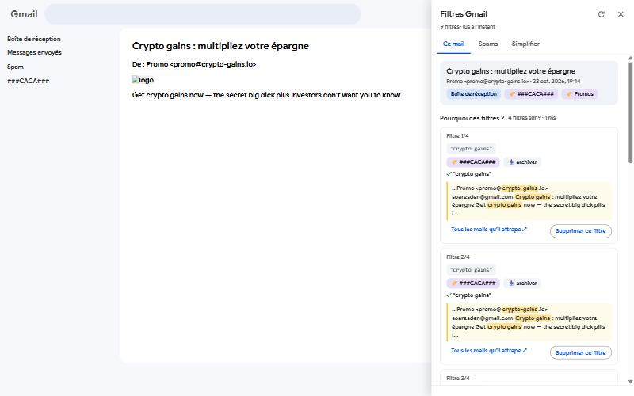
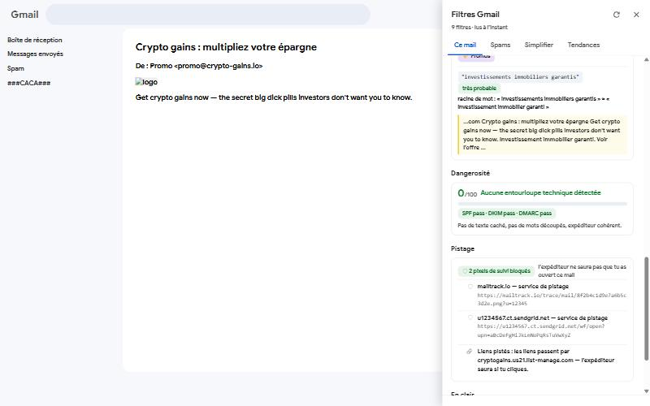
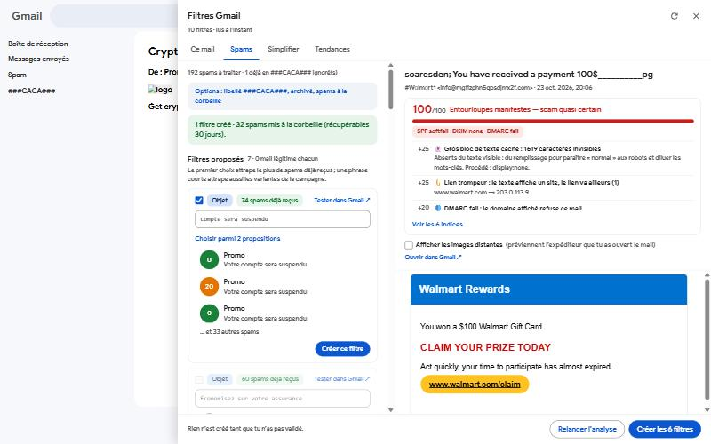
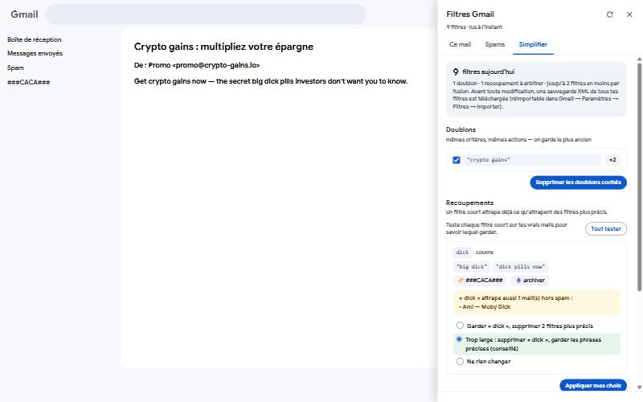
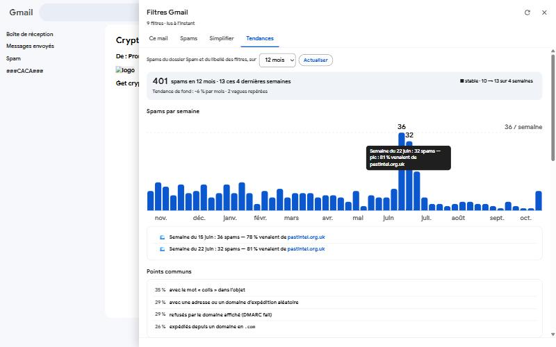

# Gmail-Filters-Detection

**Français** · [English](README.en.md)

Extension pour **Brave / Chrome** (Manifest V3) qui s'installe dans Gmail et répond à quatre questions :

1. **Pourquoi ce mail a-t-il ce filtre ?** — quels filtres il déclenche, à cause de quelle phrase ou de quel expéditeur, et d'où vient un libellé qu'aucun filtre n'explique.
2. **Ce spam est-il dangereux ?** — note de 0 à 100 des ruses techniques (texte caché, lettres découpées, faux expéditeur, liens trompeurs, SPF/DKIM/DMARC…), et filtres proposés automatiquement pour ne plus le recevoir.
3. **Mes filtres se marchent-ils dessus ?** — doublons, filtres trop larges (« dick » qui attrape aussi « Moby Dick »), fusions possibles.
4. **D'où vient tout ce spam ?** — évolution semaine par semaine, vagues, et ce qu'ont en commun les spams (adresse exacte visée, domaines, serveurs, plateformes d'envoi).

Et, sans rien faire : **les pixels de suivi sont bloqués** dans les mails que tu ouvres.

> Les captures ci-dessous viennent du banc d'essai de l'extension (fausse boîte Gmail, données fictives). Les textes « Claude » y sont simulés.

---

## Ce que ça fait

### Ce mail : pourquoi ces filtres ?



Ouvre un mail, clique sur **Filtres** (en bas à droite) :

- la liste des filtres qui le déclenchent, avec leurs actions (libellé, archivage, corbeille) et **la phrase surlignée dans le mail** ;
- les **libellés sans filtre exact** : bouton « Chercher le filtre probable » (Gmail rapproche les racines de mots : *investissement* ≈ *investissements*) ;
- **Supprimer ce filtre** (avec confirmation) ou **créer un filtre** depuis une phrase sélectionnée dans le mail, avec un bouton **Tester** qui compte les vrais mails qu'il attraperait ;
- **Expliquer avec Claude** (facultatif) : une explication en clair, qui signale les filtres trop larges.

### Dangerosité et pistage



- **Dangerosité** : score 0–100 et liste des ruses détectées (texte caché absent du texte visible, mots découpés lettre par lettre, caractères Unicode sosies, liens dont le texte affiche un site et qui vont ailleurs, nom d'affichage qui imite une marque, SPF/DKIM/DMARC en échec…). Les mails transférés par un service d'alias (Firefox Relay, Apple « Masquer mon adresse », DuckDuckGo, SimpleLogin, addy.io, Proton Pass) sont jugés sur leur expéditeur d'origine, et les liens de suivi des plateformes d'envoi ne comptent pas comme pièges.
- **Pistage** : pixels de suivi bloqués (service, raison), et liens qui passent par un compteur de clics.

### Dossier Spam : danger + filtres automatiques



- chaque spam avec sa **note de danger**, et son **aperçu** à droite (scripts, liens et images distantes désactivés ; les images peuvent être affichées sur demande, les pixels de suivi restent retirés) ;
- des **filtres proposés**, chacun testé dans ta vraie boîte pour attraper ce spam et **0 mail légitime** : uniquement des **mots** (phrase exacte de l'objet ou du corps), jamais l'expéditeur — les spammeurs changent d'adresse à chaque envoi, pas de texte. Si rien de sûr n'est trouvé, Claude peut en proposer (facultatif) ;
- **plusieurs propositions par spam**, la meilleure en premier : celle qui attrape le plus de spams déjà reçus, puis la plus courte (une phrase courte attrape aussi les variantes de la campagne). Les filtres sur l'objet sont des phrases exactes : `subject:"…"` ;
- **un par un** (« Créer ce filtre » sur chaque carte) ou tous les cochés d'un coup : filtres créés (libellé `###CACA###` + archivage par défaut), spams traités mis à la corbeille (récupérables 30 jours).

### Simplifier mes filtres



- **Doublons** : mêmes critères, mêmes actions → on garde le plus ancien.
- **Recoupements** : un filtre court (`dick`) attrape déjà ce qu'attrapent des filtres plus précis (`"big dick"`, `"dick pills now"`). **Tester sur mes mails** cherche dans ta boîte ce que le filtre court attraperait hors spam : rien → les filtres précis sont inutiles ; des vrais mails (« Moby Dick ») → il est trop large, on garde les phrases précises.
- **Fusions** : des filtres simples aux mêmes actions regroupés en un seul `"a" OR "b" OR …`.
- Avant toute modification, **une sauvegarde XML de tous tes filtres est téléchargée** (réimportable dans Gmail → Paramètres → Filtres → Importer). Les opérations sont faites une par une et reprennent là où elles en étaient si le navigateur coupe.

### Tendances : d'où vient tout ce spam ?



- spams par semaine (dossier Spam + libellé des filtres), tendance, **vagues** et le domaine qui les explique ;
- **points communs** : ce qui revient dans au moins un quart des spams ;
- **adresse visée** : Gmail ignore les points et le « + » (pour `jeandupont@gmail.com`, les adresses `jean.dupont@gmail.com` et `jeandupont+shop@gmail.com` arrivent dans la même boîte), mais pas les bases de données qui ont fuité — **une écriture différente désigne la liste d'origine**. Avec un service d'alias (Firefox Relay…), chaque alias n'a été donné qu'à un site : **l'alias visé désigne le site qui a fuité** ;
- domaines, serveurs (IP /24), plateformes d'envoi, extensions, mots des objets ;
- **Trouver le point commun avec Claude** (facultatif) : n'envoie que les statistiques, jamais le contenu des mails.

### Blocage des pixels de suivi

Activé par défaut (désactivable dans les options). Dans chaque mail affiché, l'extension retire avant chargement :
- les images des **services de pistage connus** (Mailtrack, Yesware, HubSpot, Mailchimp, SendGrid, Klaviyo, Amazon SES, Brevo, Mailjet, Customer.io, Intercom, Postmark…) ;
- les images **minuscules ou cachées** (1×1, `display:none`…) et les adresses de type compteur d'ouverture.

Gmail affiche les images via son proxy : l'expéditeur ne voit pas ton adresse IP, mais il sait que tu as ouvert le mail et quand — c'est ce que l'extension empêche. Pour une protection totale, active aussi dans Gmail : *Paramètres → Images → Demander avant d'afficher des images externes*.

---

## Installation (une fois, ~10 min)

### 1. Charger l'extension
1. Clone ce dépôt (ex. `D:\DOCS\Documents\GitHub\Gmail-Filters-Detection`).
2. Ouvre `brave://extensions` (ou `chrome://extensions`), active le **Mode développeur**.
3. **Charger l'extension non empaquetée** → choisis le dossier du dépôt (celui qui contient `manifest.json`).
4. Vérifie que l'ID affiché est **`ndmccgjpdbekpbjdiknmadiifhjchpdj`** (fixé par la clé du manifeste).

### 2. Créer l'accès à l'API Gmail (Google Cloud)
1. <https://console.cloud.google.com/> → **Nouveau projet**.
2. **API et services → Bibliothèque** → « Gmail API » → **Activer**.
3. **Google Auth Platform** (écran de consentement OAuth) : type **Externe**, puis **Audience → Utilisateurs test** → ajoute ton adresse Gmail.
4. **Clients → Créer un client** → type **Application Web** → *URI de redirection autorisés* :
   `https://ndmccgjpdbekpbjdiknmadiifhjchpdj.chromiumapp.org/` (avec le `/` final) → **Créer**.
   *(Pas « Extension Chrome » : ce type ne marche que dans Google Chrome connecté à un compte, pas sous Brave ni Edge.)*
5. Copie l'**ID client** (`xxxxx.apps.googleusercontent.com`). Le code secret ne sert pas.

### 3. Brancher l'ID client
1. Dans `manifest.json`, remplace `COLLE_ICI_TON_CLIENT_ID.apps.googleusercontent.com` par ton ID client.
   *(Ne le commite pas : garde-le en local.)*
2. Dans `brave://extensions`, clique sur ↻ sur l'extension, puis **F5 dans Gmail**.

### 4. (Facultatif) Claude
Clic droit sur l'icône de l'extension → **Options** → colle ta clé API Anthropic (`sk-ant-…`) et vérifie le nom du modèle (`claude-sonnet-5-5` par défaut). Sans clé, tout fonctionne sauf les explications et les propositions de Claude.

### 5. Utilisation
Dans Gmail, bouton **Filtres** en bas à droite (ou icône de l'extension). La première fois, Google demande l'autorisation : écran « Google n'a pas validé cette appli » → *Continuer* (c'est ton propre projet) et **coche toutes les cases**.

### En cas de souci
- `brave://extensions` → lien **service worker** de l'extension → **Console** : chaque étape y est journalisée (`[Traiter mes spams] …`).
- `Error 400: invalid_request` / « Custom URI scheme » : le client OAuth n'est pas de type *Application Web*, ou l'URI de redirection manque.
- `redirect_uri_mismatch` : l'URI de redirection n'est pas exactement celle ci-dessus (attention au `/` final) ; Google peut mettre quelques minutes à la prendre en compte.

---

## Confidentialité : qu'est-ce qui part où ?

| Donnée | Destination | Quand |
|---|---|---|
| Mails, filtres, libellés | **API Gmail** (Google), avec ton autorisation OAuth | à chaque analyse |
| Cache des filtres et des en-têtes de spam | ton navigateur (`chrome.storage.local`) | — |
| Clé API Anthropic | ton navigateur uniquement (jamais synchronisée) | — |
| Expéditeur, objet, extrait du mail, filtres trouvés | **API Anthropic** | seulement si tu cliques « Expliquer avec Claude » |
| Spams sans critère sûr (expéditeur, objet, début du texte) | **API Anthropic** | seulement si une clé est renseignée et le mode « Claude en secours » actif |
| Statistiques agrégées (aucun contenu de mail) | **API Anthropic** | seulement si tu cliques « Trouver le point commun avec Claude » |

Autorisations Gmail demandées : `gmail.modify` (lire, étiqueter, mettre à la corbeille — **jamais de suppression définitive de mail**) et `gmail.settings.basic` (lire, créer et supprimer des filtres). Un jeton d'accès dure environ une heure ; ensuite l'extension le renouvelle, en rouvrant brièvement la fenêtre Google si besoin.

---

## Pour les développeurs

```bash
npm test
```

Node 20+, aucune dépendance. Trois suites : le moteur d'analyse des spams, le code porté de *Gmail Filters Manager* (moteur de requêtes Gmail, filtres d'un mail, indicateur spam, simplification, tendances), et un test d'intégration du service worker complet face à une fausse API Gmail (aucun accès réseau).

| Fichier | Rôle |
|---|---|
| `manifest.json` | extension MV3 (service worker module, deux scripts de contenu) |
| `background.js` | aiguillage des demandes du panneau vers les modules |
| `gmail-api.js` | connexion Google (`launchWebAuthFlow`), API Gmail, API Claude |
| `filters.js` | index des filtres (cache), « pourquoi ce filtre ? », créer / supprimer, simplification |
| `spam.js` | dossier Spam : dangerosité, aperçu, filtres proposés, création |
| `stats.js` | tendances des spams (en-têtes lus une seule fois, cache) |
| `analyzer.js` | critères de filtre candidats pour un spam |
| `lib/gfm-*.js` | code porté de l'ancien add-on Apps Script : requêtes Gmail, texte, correspondance, indicateur spam, index des filtres, tendances |
| `content.js` | le panneau dans Gmail (Shadow DOM) |
| `tracking.js` | blocage des pixels de suivi (chargé dès le début de la page) |
| `options.html` / `options.js` | réglages |

### Historique

- `legacy-apps-script/Code.gs` : le premier add-on Gmail (Apps Script).
- `legacy-apps-script/gmail-filter-manager/` : **Gmail Filters Manager**, l'add-on Apps Script qui a précédé cette extension (panneau de cartes, limité à 30 s par action). Sa logique (moteur de requêtes, indicateur spam, index des filtres) a été portée dans `lib/`.

Merci à **Sandoche**, qui avait aidé à lancer ce projet il y a plus de sept ans.
